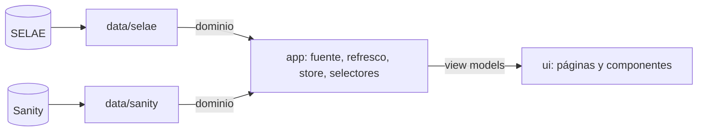

# Arquitectura

## Capas



| Capa | Responsabilidad | Puede importar |
|---|---|---|
| `domain` | Tipos de dominio, catálogo de juegos, interfaces de repositorio | Nada |
| `data` | HTTP, tipos raw, mappers y repositorios de SELAE y Sanity | `domain` |
| `app` | Configuración, reloj, resolución de fuente, refresco, store, selectores | `domain`, `data` (solo en el arranque) |
| `ui` | Páginas, componentes, estilos, logotipos | `domain` (tipos), `app` (hooks y view models) |

Reglas:
- SELAE solo se conoce en `src/data/selae/`; Sanity solo en `src/data/sanity/`. Ambos devuelven los mismos modelos de dominio.
- Un cambio en un proveedor se resuelve en sus mappers y fixtures, sin tocar `app` ni `ui`.
- `ui` no hace `fetch` y no formatea datos crudos. Los selectores entregan view models listos para pintar.
- Los repositorios se crean en `src/main.tsx` y se inyectan; no se instancian en otro sitio.

## Estructura de carpetas

```
src/
  main.tsx                     arranque: config, reloj, repositorios, stores, router
  App.tsx                      rutas
  domain/                      games, draw, next-draw, repository
  data/
    http/fetch-json.ts
    selae/                     endpoints, raw-types, parse/, mappers/, repositorio, __fixtures__/
    sanity/                    client, queries, raw-types, mappers/, repositorio, __fixtures__/
  app/
    config.ts                  query params y env
    clock.ts
    source/                    resolución SELAE → Sanity, reintentos, juegos forzados
    refresh/                   política pura, planificador, cola de SELAE, ciclo de vida (00:05, 05:00)
    store/                     estado por juego + hooks (useBoard, useNow, useBoardView, useUpcomingTiles)
    slides/                    store de slides (cada 5 min) y rotación
    selectors/                 dominio → view models (tablero, próximos, slides)
    format/                    fechas, importes, bolas
  ui/
    theme/                     tokens.css, base.css
    assets/logos/              SVG de juegos, Joker y Millón
    components/                piezas reutilizables
    results/                   ruta / y /quini
    upcoming/                  columna de próximos sorteos
    slides/                    ruta /slide
    stage/                     lienzo 1920×1080 escalado
  test/                        helpers de tests (tablero con fixtures)
sanity/
  schemas/                     esquemas publicados en el Studio alojado
sanity.config.ts               configuración mínima para `sanity deploy`
sanity.cli.ts
vercel.json                    rewrite SPA para /quini y /slide
```

## Rutas

| Ruta | Dispositivo | Datos |
|---|---|---|
| `/` | TV horizontal | Resultados (SELAE con respaldo Sanity) + próximos sorteos (SELAE) |
| `/quini` | Cualquiera (validación) | Mismo layout que `/`, solo con datos de Sanity |
| `/slide` | Tablet horizontal | Imágenes `slide` de Sanity en rotación |

Parámetros de desarrollo:
- `?mock=1`: repositorios con fixtures (SELAE y Sanity).
- `?now=2026-10-14T21:40`: solo con mock; el reloj arranca en ese instante (hora local) y sigue avanzando.

## Tooling

- Vitest (`npm test`), `npm run typecheck` (`tsc --noEmit`).
- `react-router-dom` para las rutas.
- `@sanity/client` para leer Sanity; `sanity` solo como `devDependency` para publicar esquemas.
- Estado con `useSyncExternalStore`; sin librerías de estado ni de fetching.
- CSS plano con variables; sin `styled-components`.
