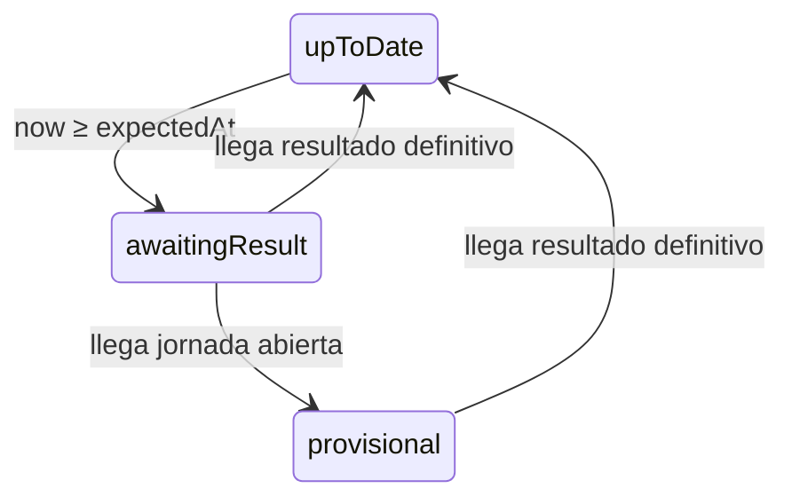

# Refresco y resolución de fuente

Todo en `src/app/`. La TV está encendida todo el día y nadie recarga la página: la app se actualiza sola, consulta SELAE solo cuando puede haber datos nuevos y, cuando un sorteo termina, muestra el resultado definitivo sin intervención.

## Sin caché persistente

- El estado vive solo en memoria. Al cargar la página se consulta todo.
- No se usa `localStorage`. Al arrancar se borran las claves del formato antiguo (`draw:*`) para no dejar basura.
- La caché persistente versionada queda fuera de alcance.

## Estado por juego

```ts
export type DrawPhase = 'upToDate' | 'awaitingResult' | 'provisional';

export interface GameState {
  draws: Draw[];                 // asc por date, solo semana en curso (ver 06-ui-resultados.md)
  next: NextDraw | null;
  phase: DrawPhase;
  lastErrorKind: ProviderErrorKind | null;
  errorCount: number;            // rondas consecutivas fallidas contra SELAE
}
export interface BoardSnapshot {
  results: Record<ResultGameId, GameState>;
  upcoming: NextDraw[];          // orden de la API
  forcedGames: ResultGameId[];
  lastUpdatedAt: string | null;
}
```

## Resolución de fuente (`source/`)

Para cada juego de resultados, en cada ronda:

1. Si el juego está en `forcedGames` (marcado en Sanity): leer de Sanity y no llamar a SELAE.
2. Si no: llamar a SELAE. Si falla, reintentar 2 veces más, a los 5 s y a los 10 s.
3. Si los 3 intentos fallan: leer de Sanity y usar sus sorteos para ese juego. `errorCount + 1`.
4. Combinar por `date` con lo que ya hubiera en memoria: SELAE gana a Sanity, salvo en juegos forzados, donde gana Sanity.
5. Si ni SELAE ni Sanity tienen datos, se mantiene lo que hubiera en memoria; sin nada, la tarjeta muestra "Pendiente de resultado".

- `forcedGames` se lee de Sanity al arrancar y cada 60 s.
- Los próximos sorteos (`next`) solo vienen de SELAE. Si fallan, se mantiene el último valor en memoria.

## Ciclo de vida de un sorteo



- `expectedAt` = `next.drawAt ?? next.date + game.resultsFromTime`.
- **Definitivo**: números con `combinacion` completa; fútbol con `status: 'final'`.
- **Provisional**: fútbol con `status: 'open'`.
- Al pasar a definitivo, en la misma ronda se pide también `next` (nuevo bote y fecha). La tarjeta cambia con un fundido de 400 ms.

## Política (`refresh/policy.ts`)

Función pura, sin timers:

```ts
decideNextCheck(input: { now: Date; game: GameInfo; state: GameState }):
  { at: Date; phase: DrawPhase; fetchResults: boolean; fetchUpcoming: boolean }
```

Reglas, en orden de prioridad:

1. **Error previo** (`errorCount > 0`): siguiente ronda en 1, 2, 5, 10, 15 min según `errorCount` (máximo 15).
2. **Sin datos**: consultar ya.
3. **Próximo sorteo caducado** (`next.date` < hoy, o último `draw.date` ≥ `next.date`): `fetchUpcoming` ya.
4. **Provisional** (fútbol):
   - Algún partido en `kickoff ≤ now ≤ kickoff + 2h15`: cada 5 min.
   - Todos los partidos terminados: cada 5 min hasta `status: 'final'`.
   - Sin partidos en juego y con partidos por empezar: en el siguiente `kickoff + 1h50`, como máximo 60 min.
5. **Esperando resultado** (`now ≥ expectedAt` y no hay sorteo con `date === next.date`): cada 5 min durante 3 h, después cada 30 min.
6. **Al día**: no consultar hasta `expectedAt`, con tope de 6 h y mínimo 1 min.

Tests en tabla con instantes fijos, al menos:
- BONO 14/10 20:00 con último sorteo 13/10 → `upToDate`, siguiente ronda 21:15.
- BONO 14/10 21:20 sin sorteo del 14/10 → `awaitingResult`, 5 min.
- BONO 14/10 21:40 con sorteo del 14/10 y `next` del 14/10 → `upToDate`, `fetchUpcoming` ya.
- BONO 15/10 01:00 sin resultado del 14/10 → 30 min.
- LAQU jornada abierta con partido a las 21:00 y now 21:30 → `provisional`, 5 min.
- LAQU jornada abierta, último partido 21:00, now 23:30 → `provisional`, 5 min.
- ELGR al día el lunes con `next` el domingo → 6 h.
- errorCount 3 → 5 min.

## Planificador (`refresh/scheduler.ts`)

- Un `setTimeout` por juego hacia `at`. Al vencer: resuelve la fuente, actualiza el estado y vuelve a decidir.
- Próximos sorteos: una sola llamada `getUpcoming()` para todos los juegos. Se pide al arrancar, cuando una política devuelve `fetchUpcoming`, cuando pasa algún `salesCloseAt` de la lista y, en reposo, cada 6 h. Varias peticiones coincidentes se agrupan en una.
- `GameState.next` de cada juego de resultados es el primer elemento de esa lista con su `gameId`.
- Cola global: máximo 2 peticiones simultáneas a SELAE y 500 ms entre arranques.
- Reprogramar todo en: evento `online`, cambio de día (00:05) y `visibilitychange` a visible.
- Recarga completa de la página a las 05:00 (configurable) para evitar fugas de memoria del kiosko.

## Store (`store/`)

```ts
createBoardStore(deps: { selae: SelaeRepository; manual: ManualRepository; clock: Clock }): {
  getSnapshot(): BoardSnapshot; subscribe(l: () => void): () => void; start(): void; stop(): void;
}
useBoard(): BoardSnapshot  // useSyncExternalStore
useNow(intervalMs): Date   // tic para cuentas atrás, cada 60 s
```

- Snapshot inmutable; el store se crea en `main.tsx` y se pasa por contexto.
- `/quini` crea el store con `sourceMode: 'manualOnly'`: los resultados se leen siempre de Sanity, sin llamar a SELAE ni esperar reintentos. Los próximos sorteos siguen viniendo de SELAE.
